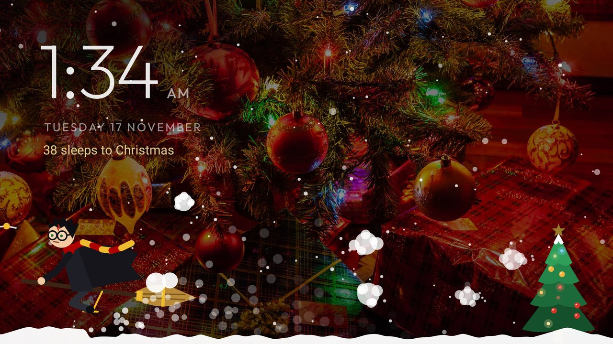
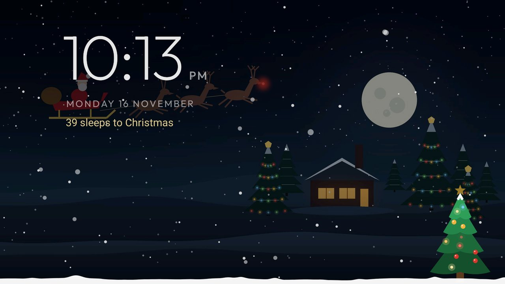

# Cozy Christmas: a candle, a bell, snow, a tree, and a plough, Santa or a broom to clear it

This branch (`christmas-skin`) is a fork of [CleanYourTV](https://github.com/Gathin23/cleanyourtv) that adds a
Christmas skin to its launcher and a `christmas` theme that turns the skin on: seven Christmas pictures and
four New Year ones. The skin runs from the theme's first day to 6 January and turns into a New Year look on the
way. Everything else is
the main repo as of commit `ddc3b2cd`; its README, prompt and tools apply unchanged.

It lives here rather than in the main repo because the main repo keeps seasonal skins out of its launcher, and
because this build is over its APK size limit (see [Cost](#cost)).

## What it adds

| Where | What you see |
|---|---|
| Network button | An Advent candle. Its flame follows the connection: taller with a stronger Wi-Fi signal, steady on Ethernet, out with a wisp of smoke when the TV is offline. The wax is full height until 1 December and a little shorter each day until the 25th |
| Inputs button | A gold bell with holly that swings twice when focused |
| Settings button | A snowflake that turns when focused |
| Home | Snow falling for as long as Home is on screen; it stops when you leave Home |
| Dock | The snow that falls over the dock collects on its top edge. When enough has collected (about every four to five minutes) a small red plough drives along the dock and clears it, alternately from the left and from the right, throwing the snow off; a few clumps hit the inside of the screen and slide down |
| Tree | A Christmas tree at the right end of the dock. It gains lights and baubles as the 25th nears, its star is lit from Christmas Day, and presents lie under it from the 25th to the 31st. Snow settles on its branches and slides off when they are full |
| Greeting | "39 sleeps to Christmas" for the 60 days before the 25th, "Merry Christmas" from the 25th to the 29th, "2 days to 2027" on the 30th, "New Year's Eve" on the 31st, "Happy New Year" in January (English only) |
| Focus glow | Candlelight (`#FFC46B`) |

### Plough, Santa or broom

Whoever applies the theme chooses who clears the snow, with one line in the theme's `config.json`:

| `snow_clearer` | What clears the snow |
|---|---|
| `"plough"` (the default) | The small red plough, as above |
| `"santa"` | The same plough with Santa at the wheel, his sack in the back (presents sticking out until Christmas Eve, empty from the 25th), antlers on the bonnet and a red nose for a headlight. It ploughs exactly as the plain one does |
| `"broom"` | A young wizard in round glasses, with untidy black hair, a scar on his forehead and a red and gold scarf, flying low over the snow on a racing broom after a small winged golden ball |

The broom never touches the snow. He crosses in six seconds; the air he drags along lifts about three quarters
of the snow into his wake as powder, which hangs for a moment and thins away, and the rest stays behind in
ripples. A few clumps still hit the inside of the screen, and the tree sheds its snow as he passes. Because some
snow is left, he comes back a little sooner than the plough would. From 30 December his broom trails gold
sparks, and he crosses the midnight fireworks twice.

The flyer is unofficial fan art: see [Licence](#licence).

### The turn of the year

The skin goes by the TV's own date:

| When | What changes |
|---|---|
| Until 29 December | Christmas, as above |
| 30 and 31 December | Still Christmas. The greeting counts down to the new year and a firework goes up now and then, more often through the evening of the 31st |
| The last ten seconds of the year | Counted down on screen, 10 to 1 |
| The first minute of 1 January | A finale of fireworks with "Happy New Year 2027" |
| 1 to 6 January | The pictures are the theme's New Year ones, the candle is a sparkler, the presents are gone, and a small volley of fireworks goes up every few minutes. The snow, the plough and the tree stay |
| From 7 January | The skin is off |

The fireworks are silent: the skin makes no sound at all.

### Screensaver

The launcher's Clock screensaver carries the skin too. Over the theme's pictures a heavier snowfall than Home's
collects along the bottom of the screen, edge to edge, with the tree (about a third of the screen's height) and
the plough or the broom, larger than on Home. With the heavier snow it is cleared about every two to three
minutes. The time and date keep to the upper left with the greeting under them, and the turn of the
year plays here as well, countdown and finale included.

It is not turned on for you: see [Use it](#use-it).

The `christmas` theme adds seven pictures that change every 20 minutes, in order, each with its photographer's
name under the buttons: the main repo's own sleigh illustration first, then six photos from Wikimedia Commons.
Four more Commons photos of New Year fireworks (`wallpapers/ny-*.jpg`) take their place from 1 January; any
theme can do the same by starting a picture's file name with `ny-`.
Authors and licences are in [`themes/christmas/CREDITS.md`](themes/christmas/CREDITS.md).

No network access, no new permission, no new dependency, no background service. With `reduced_motion` on, the
snow does not fall, so there is no plough, tree, fireworks or screensaver scene either, and the icons stay still.

## Use it

1. Build and install the launcher from this branch, the same way as the main repo:
   `launcher/build-and-install.sh`, or `tools/docker-build.sh` then `SKIP_BUILD=1 launcher/build-and-install.sh`
   if you have no JDK.
2. Push the theme: `TV_HOST=<tv ip> tools/theme.sh themes/christmas`

3. To put Santa at the plough's wheel, or to have the wizard on his broom clear the snow instead, change
   `"snow_clearer": "plough"` to `"snow_clearer": "santa"` or `"snow_clearer": "broom"` in
   `themes/christmas/config.json` and push the theme again. Changing it back and pushing again brings the plain
   plough back; nothing needs rebuilding.
4. For the screensaver, pick "Clock" in the TV's screensaver settings, or over ADB:
   `tools/tv.py 'settings put secure screensaver_components com.gathin.tvhome/.ClockDream'`.
   Note the TV's current value first (`settings get secure screensaver_components`) so you can put it back.

The skin switches itself off after 6 January 2027 (`festival_until` in the theme's `config.json`); the pictures
stay until you run `tools/theme.sh --reset`. To get the skin with your own theme, add
`"seasonal_skin": "christmas"` to its `config.json`. The keys are described in
[`themes/README.md`](themes/README.md).

## Cost

- **Size:** the APK is 610,481 B (about 596 KB) as built for the test TV. The main repo's limit is 589,824 B,
  so this branch is about 21 KB over it and fails that repo's size check. The main repo's README on this branch
  still says "about 572 KB"; that figure describes the main repo's launcher, not this one.
- **CPU:** the snow redraws about 30 times a second. On the Sony BRAVIA 4K UR3 the launcher used about 12% of
  one of its four CPU cores while idle on Home, against about 0% without the snow. With the screensaver's
  heavier snowfall up, the launcher used about 13% of one of four cores on the Sony BRAVIA 4K VH22. On Home that stops when you leave Home; the screensaver keeps it up for as long as the TV
  sits idle, which on a TV that never sleeps is all night.
- **Memory:** 76 MB on Home on the UR3 and 66 MB with the screensaver up on the VH22; the skin's first version,
  with snow only, used 67 MB on Home.

## Tested on

- Sony BRAVIA 4K UR3, Android TV 10
- Sony BRAVIA 4K VH22, Google TV 12

Checked from screenshots taken over ADB:

- On the UR3: Home with the candle, the bell, the snowflake, the falling snow, the collected snow and the tree;
  plough passes on Home and on the screensaver; Santa's plough on the screensaver, one pass from the left,
  with its heavier snowfall; the broom's flyby on Home; and, with builds whose clock was
  shifted for the test, New Year's Eve, the countdown, the finale, the change to the New Year pictures and the
  skin ending on 7 January, on Home and on the screensaver (with the plough).
- On the VH22: Home, and the screensaver with the heavier snowfall and the broom: flybys in both directions,
  about two and a quarter minutes apart; and, with a build whose clock was shifted, the broom's gold sparks on
  New Year's Eve and his two passes through the finale's fireworks.

Not checked: the candle going out when the TV is offline; how the bell swing, the snowflake turn and the flame's
flicker look in motion; the tree shedding its snow, for the plough or the broom; the broom's New Year parts on
Home; the fireworks of 30 December and of the daytime of the 31st; the volleys of 1 to 6 January; Santa's plough on Home, driving from the right, and with its sack empty from Christmas Day;
and the screensaver's load over many hours.

## What changed in the code

All in `launcher/app/src/main/java/com/gathin/tvhome/` unless a path is given.

- New: `CandleDrawable`, `ChristmasIconDrawable`, `SnowfallView` (the snow, the plough, the thrown snow, the
  screensaver's ground), `SnowDrift` (the collected snow and when the plough is due), `ChristmasTree`,
  `NewYear` (what happens on which date), `Fireworks`, `SparklerDrawable`; the broom's flyer, his wake and his
  New Year passes are in `SnowfallView` and `SnowDrift`, and Santa, his sack and the antlers in `SnowfallView`
- Changed: `Festival` (the `christmas` name, the greetings, the candle's height, `snow_clearer`), `MainActivity` (applies the
  skin, starts and stops the snow, changes look when the date does), `DockDecoration` (the dock's snow and the
  tree), `Config` (leaves the `ny-` pictures out except in the skin's January), `ClockScene` (the screensaver's
  snow scene and greeting), `strings.xml` (English strings)
- Tests: `FestivalTest`, `SnowDriftTest`, `ChristmasTreeTest`, `NewYearTest`
- Theme: `themes/christmas/` and its row in `themes/README.md`

## Licence

The code is MIT, like the main repo. The ten Commons photos keep their own licences (CC BY and CC BY-SA), listed
in `themes/christmas/CREDITS.md`.

The wizard on the broom is unofficial fan art, drawn from scratch in code for this skin. It is not affiliated
with, endorsed by or licensed from the owners of the Harry Potter books and films, whose names and characters
are their trademarks and copyright. It is off unless a theme asks for it.
